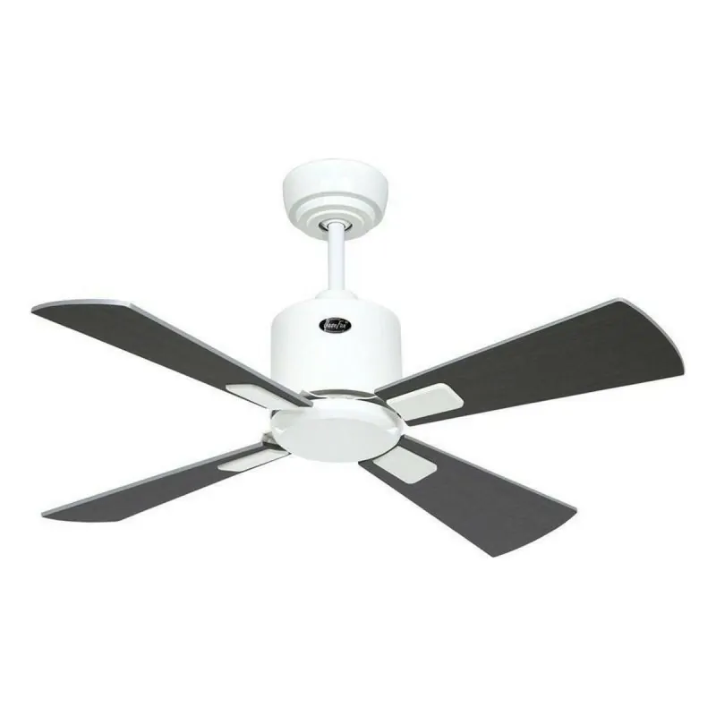
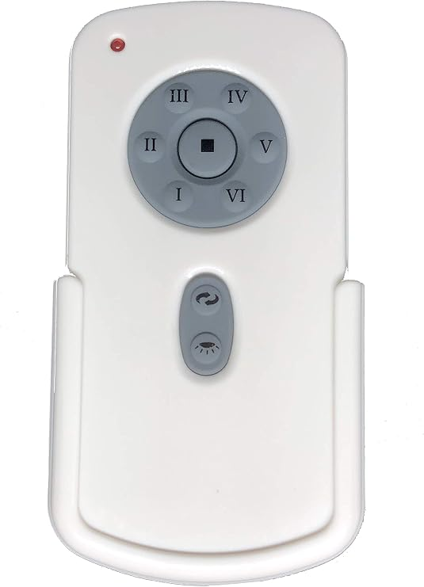

# ESPHome CasaFan Ceiling Fan Controller


Control a **CasaFan Airfusion Climate LD-CD52BN** ceiling fan from **Home Assistant** (and Alexa) by replacing its original 434 MHz RF remote with an **ESP32** connected to a **CC1101** radio module, running **ESPHome**.



## Table of contents

- [Overview](#overview)
- [Ceiling fan specifications](#ceiling-fan-specifications)
- [Original remote control](#original-remote-control)
- [Hardware](#hardware)
- [Wiring](#wiring)
- [RF protocol](#rf-protocol)
- [Installation](#installation)
- [Capturing the remote codes](#capturing-the-remote-codes)
- [Home Assistant integration](#home-assistant-integration)
- [License](#license)

## Overview

The fan is natively controlled by an RF remote (**RH787TG**) using 434 MHz OOK modulation.

This project reproduces the remote's RF frames from an ESP32, so the fan can be integrated into Home Assistant **without relying on the CasaFan hub**.

## Ceiling fan specifications

| | |
|---|---|
| **Model** | Airfusion Climate LD-CD52BN (CasaFan / Lucci Air) |
| **Receiver** | RH787RX |
| **Motor controller** | RH788R |
| **Frequency** | 434 MHz |
| **Motor** | DC, 35 W |
| **Voltage** | 220 V |
| **Direction reversal** | Handled electronically by the controller |

## Original remote control

| | |
|---|---|
| **Reference** | RH787TG |
| **DIP switches** | 4 micro-switches (SW1) |
| **SET button** | 1 |
| **Speed buttons** | 6 |
| **Summer / winter** (rotation direction) button | 1 |
| **Light button** | 1 |
| **Stop button** | 1 |

That makes **9 distinct RF commands** in total.



## Hardware

- [EBYTE **E07-M1101D-TH** CC1101 module (SMA antenna)](images/cc1101-TI-sma.jpg) 
- [ESP32-C3 Super Mini** (16 pins, USB-C)](images/ESP32-C3-Super-Mini-Pinout.png) 

## Wiring

| CC1101 pin | Function | ESP32-C3 |
|:---:|---|:---:|
| 1 – GND | Ground | GND |
| 2 – VCC | Power | 3V3 |
| 3 – GDO0 | RF TX | GPIO7 |
| 4 – CSN | Chip Select | GPIO3 |
| 5 – SCK | SPI Clock | GPIO4 |
| 6 – MOSI | SPI MOSI | GPIO6 |
| 7 – MISO | SPI MISO | GPIO5 |
| 8 – GDO2 | RF RX | GPIO10 |

## RF protocol

- Modulation: **OOK**, 434 MHz
- `symbol_rate: 5000`
- `filter_bandwidth: 325kHz`

The code can capture the frames sent by the original remote when reception mode is enabled. The captured frames must then be copied into the `## SCRIPTS ##` section of the code, for each of the 9 buttons (speeds 1 to 6, light, rotation direction and stop).

## Installation

1. Install [ESPHome](https://esphome.io/).
2. Copy `secrets.yaml.example` to `secrets.yaml` and fill in your Wi-Fi credentials.

   > [!WARNING]
   > `secrets.yaml` is ignored by Git. Never commit it.

3. Flash the configuration to the ESP32:

   ```bash
   esphome run casafan.yaml
   ```

4. Open the device's web interface in a browser, using either the IP address assigned by your DHCP server or <http://casafan-cc1101-c3mini.local/>.

## Capturing the remote codes

1. In the [device's web interface](images/webserver1.png), enable [**reception mode**.](images/webserver2.png)
2. Press each of the 9 buttons on the original remote: speeds 1 to 6, light, rotation direction and stop.
3. Copy the captured frames into a text file.
4. Paste them into the `## SCRIPTS ##` section of the code, then re-flash the ESP.

## Home Assistant integration

Once the ESP is flashed and online, add it to Home Assistant after installing the [ESPHome Device Builder](https://esphome.io/install/getting-started/) add-on.
[](images/HAOS-integration.png)
## License

[MIT](LICENSE): free to reuse, with credit to the source appreciated.
